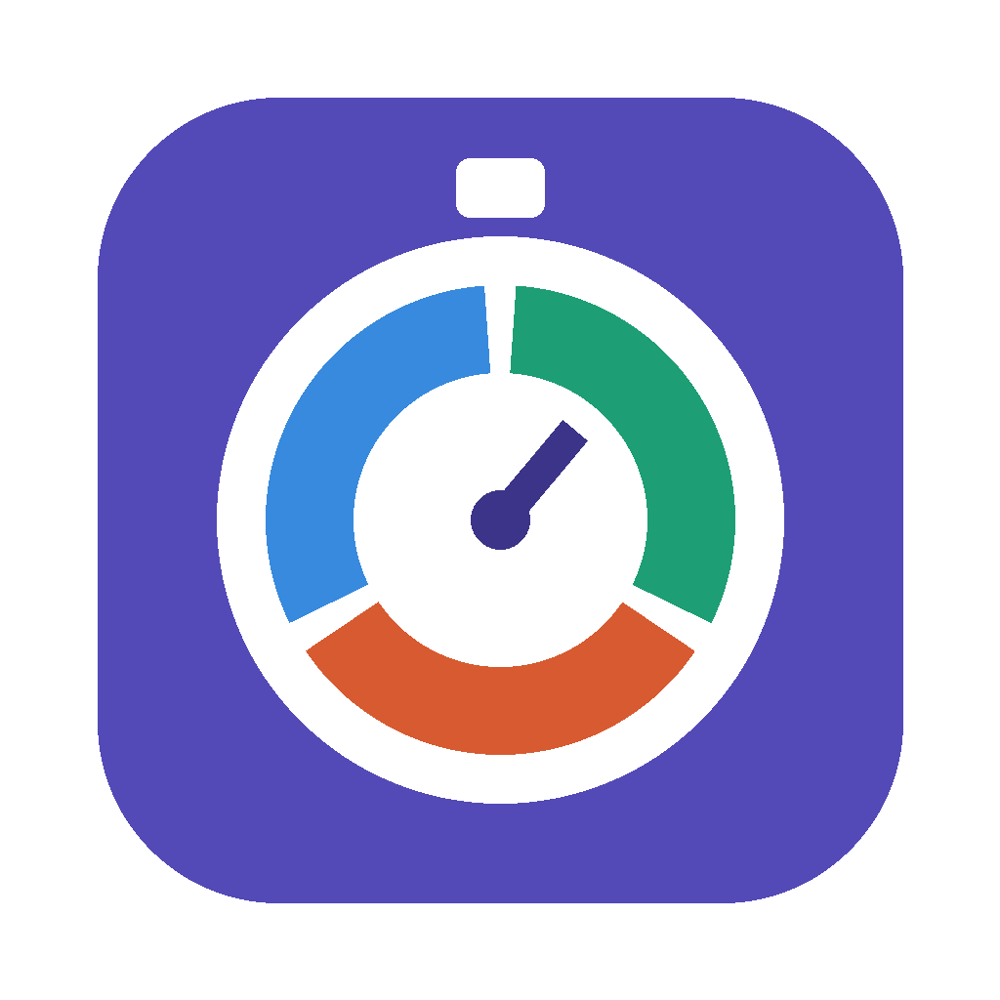

  

<h1 align="center">Multitarefa</h1>

  

macOS 13 (Ventura) ou mais novo · Apple Silicon e Intel

App de Mac para trabalhar em várias tarefas em rodízio. Cada tarefa ganha uma rodada de 10 minutos. Quando o alarme toca, o app passa pra próxima, e assim vai até você concluir tudo.

## Como funciona

- **Rodízio:** a tarefa do topo da fila é a atual. Quando o timer dela zera, toca um alarme, ela vai pro fim da fila (com o timer zerado de novo) e a próxima começa.
- **Aviso de 1 minuto:** um som suave avisa que está acabando, pra você fechar o raciocínio.
- **"Onde parei":** quando a rodada termina, o app pede uma frase curta de onde você parou. Quando a tarefa volta, essa frase aparece em destaque.
- **Concluir:** clique no círculo da tarefa (a qualquer momento, mesmo antes do timer acabar).
- **Arquivar:** o ícone de caixa guarda a tarefa pra depois. Ela pode voltar pra fila na aba Arquivadas.
- **Histórico:** cada tarefa concluída mostra o tempo total que você passou nela, somando todas as rodadas, e quantas rodadas levou.
- **Barra de menus:** o tempo restante fica sempre visível lá em cima. Fechar a janela não para o timer.
- **Salva sozinho:** as tarefas ficam em `~/Library/Application Support/Multitarefa/state.json`.

### Atalhos

| Atalho | Ação |
|---|---|
| ⌘ ↩ | Iniciar ou pausar |
| ⌘ → | Próxima tarefa |
| ⌘ D | Concluir a tarefa atual |

## Instalar

1. Clique no botão **Baixar para macOS** no topo desta página (ou [baixe aqui](https://github.com/Tamiozzo22/Multitarefa/releases/download/latest/Multitarefa.zip)).
2. Abra o zip e arraste `Multitarefa.app` para a pasta **Aplicativos**.
3. Na primeira vez, o macOS bloqueia porque o app não é de um desenvolvedor registrado na Apple. Vá em **Ajustes do Sistema → Privacidade e Segurança**, desça até o fim e clique em **Abrir Mesmo Assim**. Só precisa fazer isso uma vez.
4. Permita as notificações quando o app pedir.

## Como o app é compilado

Toda vez que o código muda na branch `main`, o GitHub Actions compila o app num Mac da nuvem (`scripts/build-app.sh`) e publica o zip em **Releases → latest**. Dá pra acompanhar na aba **Actions**.

Pra mudar a duração das rodadas, edite `slotSeconds` em `Sources/Multitarefa/TaskStore.swift`.
